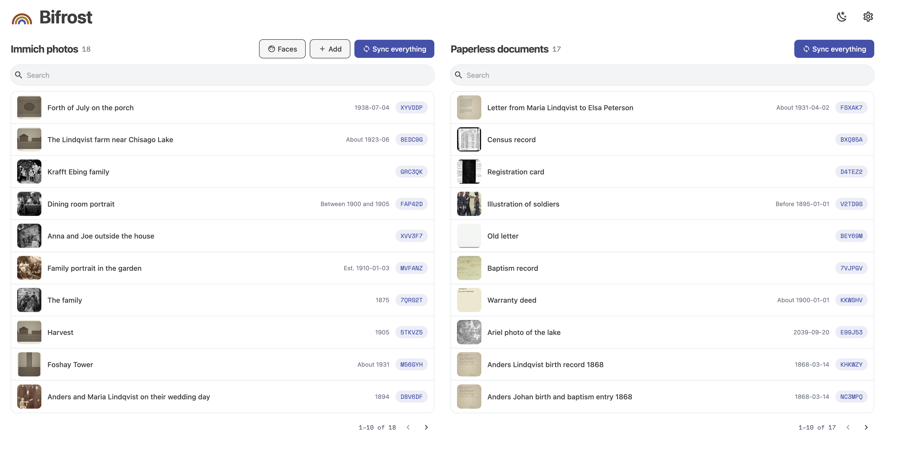

<p align="center">
  <picture>
    
  </picture>
</p>

# Bifrost

Bifrost is a companion web app for a [Gramps Web](https://www.grampsweb.org) family tree. It brings the photos in [Immich](https://immich.app) and the documents in [Paperless-ngx](https://docs.paperless-ngx.com) into Gramps as media objects and keeps them up to date, so each file lives in one place.

## What it does

* Pick an Immich photo, give it a title, date, place, notes and links, and it becomes a Gramps media object. You can link scans of the same photo.
* Pair an Immich person with a Gramps person and every synced photo will get face boxes in Gramps.
* Paperless documents become Gramps media objects with title, date, file version, transcription and custom fields.
* Run OCR on Paperless documents. Their transcription is saved in Paperless and in Gramps as a Media Note.

One button per service brings Gramps up to date with every tagged photo or document.

## Screenshot

<p align="left">
  <picture>
    
  </picture>
</p>


## Quick start

Bifrost has no login so run it on a trusted network or behind an authenticating reverse proxy.

You need Gramps Web, plus Immich, Paperless-ngx or both.

```bash
git clone https://github.com/petermgrund/bifrost && cd bifrost
```

```bash
cp config.example.yaml config.yaml
```

Fill in `config.yaml`, then:

```bash
docker compose up -d
```

Open `http://<host>:8800`. The gear icon shows whether each service answers. [Using Bifrost](docs/using.md) covers the rest.

| | |
| --- | --- |
| Update | `git pull && docker compose pull && docker compose up -d` |
| Build from source | `docker compose up -d --build` |
| Check connections | `docker compose exec bifrost python -m bifrost.cli doctor` |

## Setting up the other services

Gramps reads the files in place, so mount them read-only into Gramps' media folder.

### Immich

| Step | `config.yaml`, `immich` section |
| --- | --- |
| Create an API key for up to two accounts | `accounts` |
| Mount Immich's `upload` folder into Gramps' media folder as `immich/` | `path_mappings` |
| Mount Immich's `thumbs` folder into Gramps' media folder as `immich-previews/` for photos a browser cannot show such as HEIC | `previews_prefix` |

In Immich, tags and recognised faces belong to each user. If your family photos are spread over two accounts, for example yours and a partner's, give Bifrost an API key for each so it can read both.

### Paperless-ngx

| Step | `config.yaml`, `paperless` section |
| --- | --- |
| Create an API token | `api_token` |
| Create a text custom field and a URL custom field which Bifrost will use to write the Gramps ID and link to | `gramps_id_field`, `gramps_url_field` |
| Create a tag for the documents to sync | `sync_tags` |
| Mount Paperless' `media/documents/originals` folder into Gramps' media folder as `paperless/` | |
| Optional: a select custom field with the options Exact, Circa, Before, After, Year only, Decade only | `date_qualifier_field` |
| Optional: a tag for the documents to transcribe, and a Gemini API key | `ocr_tag`, `gemini.api_key` |

Custom fields and tags are given by name or by id.

To sync a document as soon as it changes add a Paperless workflow:

| | |
| --- | --- |
| Triggers | Document added, Document updated, filtered to your sync and OCR tags |
| Action | Webhook to `http://<bifrost>:8800/sync/api/paperless/webhook` |
| Parameter | `doc_id` = `{{doc_id}}` |
| Header | `X-Bifrost-Token` = `paperless.webhook_token` |

## License

[MIT](LICENSE)
